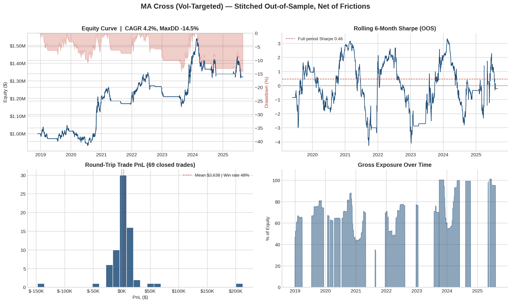

# Event-Driven Backtesting Engine with Realistic Frictions

A reusable event-driven backtester that refuses to lie to you: slippage,
commissions, borrow costs, and capacity constraints are modeled explicitly,
and the only performance number reported is stitched **out-of-sample**
equity from anchored walk-forward validation.

## Quickstart

```bash
pip install pandas numpy matplotlib          # core
pip install yfinance                         # optional, for real data
python run_backtest.py                       # runs offline on synthetic data
```

Outputs: `tearsheet.png`, `walk_forward_folds.csv`, `trades.csv`, and a
console summary that prints the "overfitting tax" (mean in-sample Sharpe
minus mean out-of-sample Sharpe).



*Sample tearsheet from the synthetic-data run: stitched out-of-sample equity
and drawdown, rolling Sharpe, trade P&L distribution, and exposure.*

## Tests

```bash
python tests.py
```

Checks the guarantees the engine depends on: strategies can never see past the
simulation clock, fills are clipped to volume capacity, short round trips book
correct P&L under FIFO, and the deflated Sharpe ratio falls as the number of
trials grows.

## Architecture

```
ebt/
  events.py      MARKET -> SIGNAL -> ORDER -> FILL dataclasses
  data.py        DataHandler: causal clock; strategies see history() only
  strategy.py    MACrossVolTarget sample; subclass Strategy for your own
  portfolio.py   sizing (target weight -> share delta), no-trade band,
                 mark-to-market, daily borrow accrual on shorts
  execution.py   fill model: half-spread + Almgren sqrt impact
                 (eta * sigma_daily * sqrt(participation)), commissions,
                 fills clipped to max_participation of bar volume,
                 residual shares worked at subsequent opens
  engine.py      the event loop (signal on close t, fill at open t+1)
  validation.py  anchored walk-forward: grid-search on IS, freeze, run OOS
  metrics.py     CAGR, Sharpe, Sortino, Calmar, drawdown, turnover,
                 deflated Sharpe ratio (corrects for # of trials)
  tearsheet.py   equity+DD, rolling Sharpe, trade PnL histogram, exposure
```

## How lookahead is prevented (by construction, not discipline)

1. **Causal accessor**: strategies receive the `DataHandler`, never the raw
   DataFrame. `history()` slices at the simulation clock; touching the
   future requires deliberately calling the broker-only `next_bar()`.
2. **Decision/execution gap**: signals are computed on bar *t*'s close and
   filled at bar *t+1*'s open. You never trade a price your signal used.
3. **Walk-forward hygiene**: parameters are selected on in-sample Sharpe
   only, then frozen for the OOS window. OOS warm-up bars (needed to seed
   the slow MA) are excluded from reported P&L.

## The friction model, briefly

- **Spread**: you pay half the quoted spread on every fill, always.
- **Impact**: square-root law, `price * eta * sigma_d * sqrt(qty/volume)` —
  trading 5% of ADV in a sleepy utility is not the same as in a biotech.
- **Capacity**: fills are hard-clipped to `max_participation` (default 5%)
  of the bar's actual volume; the residual keeps working at the next
  opens (a new order for the symbol cancel-replaces it). Scale
  `initial_capital` up and watch the strategy's Sharpe decay — that decay
  *is* the capacity curve.
- **Borrow**: shorts accrue `borrow_rate_annual / 252` daily on marked
  value. For real work, feed FRED (DFF or SOFR) plus a stock-loan spread.
- **No-trade band**: orders under `rebalance_band` (5% of equity) are
  skipped, since paying the spread to correct 40bps of weight drift is how
  vol-targeted strategies bleed to death.

## Using real data

```python
from ebt import data as datamod
data = datamod.from_yahoo(["SPY"], "2016-01-01", "2026-01-01")
# or: datamod.from_csv("spy.csv", "SPY")
```

Yahoo's adjusted closes embed dividends into prices, which slightly flatters
long-only results; Polygon's unadjusted data plus explicit dividend handling
is the professional upgrade. Note also that single-ticker tests dodge
survivorship bias, but any universe-based strategy needs point-in-time
constituent lists.

## Suggested extensions (in rough order of pain)

1. Multi-asset portfolio with cross-sectional momentum.
2. White's reality check / SPA test alongside the deflated Sharpe ratio.
3. Comparison harness against `vectorbt` or `backtrader` on identical
   data — the divergence between their frictionless defaults and this
   engine's net numbers is the entire thesis of the project.
